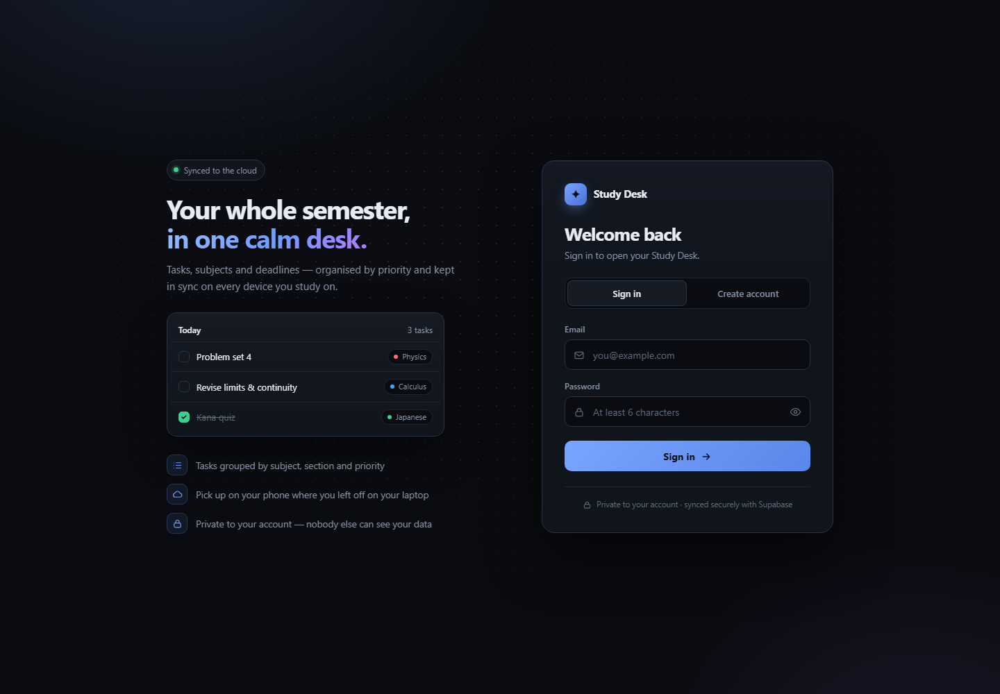

<div align="center">

# ✦ Paperly

**Study Desk — a calm, cloud-synced workspace for your whole semester.**

[](https://variableisundefined.github.io/paperly/)
[](#quick-start)
[](#testing)
[](#testing)
[](#license)
[](#tech-stack)
[](#tech-stack)
[](#tech-stack)
[](#tech-stack)

[Overview](#overview) · [Features](#features) · [Demo](#demo--visuals) · [Quick Start](#quick-start) · [Usage](#usage) · [Contributing](#contributing)

</div>

---

## Overview

Students rarely have one place for coursework, deadlines, life admin, and the little things they want to learn. Notes get scattered, priorities get lost, and the same task list has to be rebuilt on every device.

**Paperly** is a single-page study desk called **Study Desk**. It keeps tasks, subjects, sections, and deadlines in one focused view, then syncs everything to Supabase so the same desk follows you from phone to laptop. Each account only sees its own data.

It is built for students who want a lightweight planner without installing a framework, running a build step, or managing a server.

> **Highlights:** no build tools · no framework · one HTML file · per-user cloud sync · JSON backups

## Features

### Organise your semester

- Seven task sections — **Daily**, **Completions**, **Backlog**, **Chores**, **Hobbies**, **When bored** — plus an **All tasks** view.
- Group tasks by subject with colour-coded chips; add or remove subjects whenever you like.
- Set a **priority** (High / Medium / Low), an optional **deadline**, and an optional **note** for every task.
- Collapse subject groups and remember the collapsed state per account.

### Find the right task fast

- Live search across task name, subject, and section — press `/` to jump to the search box.
- Filter by status (all / pending / completed) and by priority.
- Sort by priority, High → Low or Low → High.
- Summary counters for open, completed, due today, and overdue tasks.

### Stay in sync and in control

- Email/password sign-up, sign-in, email confirmation, resend confirmation, and sign-out via Supabase Auth.
- Automatic cloud sync with a visible status pill; click it to refresh manually.
- Row Level Security policies keep tasks and subjects private to the signed-in user.
- Existing browser-only data is migrated into the cloud on first sign-in.
- Export and import a plain JSON backup; imports confirm before replacing cloud data and roll back if they fail.
- Inline edit, complete, and delete actions, with an **Undo** toast after deletions.

### Built for real devices

- Responsive dark interface with a dedicated mobile layout.
- Keyboard shortcuts and visible focus states for desktop use.
- Touch-friendly controls that avoid lingering focus rings after a selection.

## Demo & Visuals

**[▶ Open the live demo](https://variableisundefined.github.io/paperly/)** — hosted with GitHub Pages.



> [TODO: Add a screenshot of the signed-in dashboard with tasks grouped by subject.]

| Visual | Suggested alt text | Status |
| --- | --- | --- |
| Desktop dashboard | "Study Desk dashboard with Daily tasks grouped by subject and a summary of open, completed, and overdue tasks" | [TODO: add screenshot] |
| Mobile dashboard | "Study Desk on a phone showing section tabs, filters, and subject groups" | [TODO: add screenshot] |
| Backup walkthrough | "Export backup button, JSON file, and import confirmation dialog" | [TODO: add GIF] |

### Architecture

```mermaid
flowchart LR
    U[Student] --> B[Study Desk<br/>index.html]
    B -->|supabase-js v2 via CDN| A[Supabase Auth]
    B -->|PostgREST reads and writes| D[(Postgres<br/>tasks + subjects)]
    A --> R[Row Level Security<br/>user_id = auth.uid()]
    D --- R
```

### Tech stack

| Layer | Choice |
| --- | --- |
| UI | HTML5, CSS3, vanilla JavaScript |
| SDK | `@supabase/supabase-js` v2, loaded from jsDelivr |
| Backend | Supabase Auth, Supabase Postgres, Row Level Security |
| Hosting | GitHub Pages |
| Build / package manager | None — the app is a static `index.html` |

## Quick Start

### Prerequisites

- A modern browser with JavaScript enabled.
- Internet access, for the Supabase SDK and backend.
- **Optional:** Git and Python 3 if you want to run the app locally.
- **Optional:** a Supabase project if you want to use your own backend instead of the demo project.

### Run locally

```bash
git clone https://github.com/variableisundefined/paperly.git
cd paperly
python -m http.server 8000
```

Expected output:

```text
Serving HTTP on 0.0.0.0 port 8000 (http://0.0.0.0:8000/) ...
```

Open <http://localhost:8000> in your browser, then sign up or sign in.

> You can also open `index.html` directly, but serving over HTTP is recommended so Supabase sessions and confirmation redirects behave correctly.

### Connect your own Supabase project

1. Create a Supabase project and enable **Email** under *Authentication → Sign In / Providers*.
2. Create the `public.subjects` and `public.tasks` tables. The columns used by the app are listed below.
   > [TODO: Add a `schema.sql` migration with table definitions, keys, and constraints.]
3. Open *SQL Editor → New query*, paste the contents of [`fix-supabase-permissions.sql`](fix-supabase-permissions.sql), and run it. It is safe to re-run and verifies the grants and policies at the end.
4. In [`index.html`](index.html), replace `SUPABASE_URL` and `SUPABASE_PUBLISHABLE_KEY` near the top of the script block with your project URL and publishable key.
5. Under *Authentication → URL Configuration*, add your local or deployed origin to **Site URL** and **Redirect URLs**.
6. Reload the app and create an account.

| Table | Columns used by the app |
| --- | --- |
| `public.subjects` | `id`, `user_id`, `name`, `color`, `created_at` |
| `public.tasks` | `id`, `user_id`, `name`, `section`, `subject_id`, `priority`, `due_date`, `note`, `done`, `created_at`, `updated_at` |

Allowed values used by the UI: `section` ∈ `Daily`, `Completions`, `Backlog`, `Chores`, `Boredom`, `Hobbies`; `priority` ∈ `High`, `Medium`, `Low`.

### Environment variables

None are required. This is a static HTML file with no build step, so it does not read `.env` files. The Supabase URL and **publishable** key are defined as constants in `index.html`; the publishable key is designed for client-side use, and access control is enforced by the RLS policies.

> [TODO: If a build step is added later, create `.env.example` with `SUPABASE_URL` and `SUPABASE_PUBLISHABLE_KEY` and wire it into the build.]

## Usage

### Everyday workflow

1. Sign in. The desk opens on the **Daily** view with today's date and your summary counters.
2. Use the **Add a task** form: enter a name, choose a section and optional subject, set a priority, and add an optional deadline or note.
3. Tick a task to complete it, or use the edit and delete actions on the task row. A deleted task can be restored with **Undo**.
4. Switch section tabs, search, filter, or sort to find what matters now.
5. Click the **Synced** pill at any time to pull the latest data from the cloud.

### Keyboard and controls

| Input | Action |
| --- | --- |
| `/` | Focus the search field |
| `Escape` | Cancel task editing |
| `Enter` in the new-subject field | Add the subject |
| Click a subject group header | Collapse or expand that group |
| Click the sync pill | Refresh from the cloud |

### Backup and restore

Use **Export backup** in the header to download a JSON file named `study-desk-backup-YYYY-MM-DD.json`. **Import backup** accepts the same shape and asks for confirmation before replacing your cloud tasks and subjects.

```json
{
  "tasks": [
    {
      "id": "example-task-id",
      "name": "Revise limits & continuity",
      "section": "Daily",
      "subject": "Calculus",
      "priority": "High",
      "due": "2026-11-30",
      "note": "",
      "done": false
    }
  ],
  "subjects": ["Physics", "Calculus"]
}
```

If an import fails partway through, the app attempts to restore the previous snapshot and reports the outcome in a toast.

## Project Structure

```text
paperly/
├── index.html                            # Entire app: markup, styles, and logic
├── fix-supabase-permissions.sql          # Supabase grants and RLS policies
├── study-desk-backup-2026-11-26 (2).json # Example exported backup
├── docs/
│   └── screenshots/
│       └── auth-desktop.png              # Sign-in screen preview
├── README.md                             # This guide
├── .gitignore                            # Ignores the local practicing folder
├── Personal Notes/
│   └── nodemon.json                      # Local Python scratch config (not used by the app)
└── Practicing/
    ├── nodemon.json                      # Local Python scratch config (not used by the app)
    └── run.py                            # Python lists/tuples practice script
```

## Contributing

Contributions are welcome. To get started:

1. Fork the repository and create a branch, for example `feature/better-filters`.
2. Make your change in `index.html` (or add the relevant SQL/docs file).
3. Run the local smoke checks below.
4. Commit with a short imperative message, push your branch, and open a pull request.

### Testing

There is no automated test suite or CI workflow yet.

> [TODO: Add automated tests and a CI workflow, then replace the CI and test badges.]

Manual smoke checklist:

- [ ] Sign up, confirm the account if required, sign in, and sign out.
- [ ] Add, edit, complete, and delete a task; restore a deleted task with Undo.
- [ ] Filter by status and priority, sort both ways, and search with `/`.
- [ ] Add and remove a subject, then reload to confirm it synced.
- [ ] Export a backup, import it back, and verify the task and subject counts.
- [ ] Check the desktop and narrow/mobile layouts.
- [ ] Confirm no browser console errors appear during the flow.

## License

> [TODO: Choose a license, add a `LICENSE` file, and update the license badge.]

No license file is present in the repository yet, so the default "all rights reserved" terms apply until one is added.
